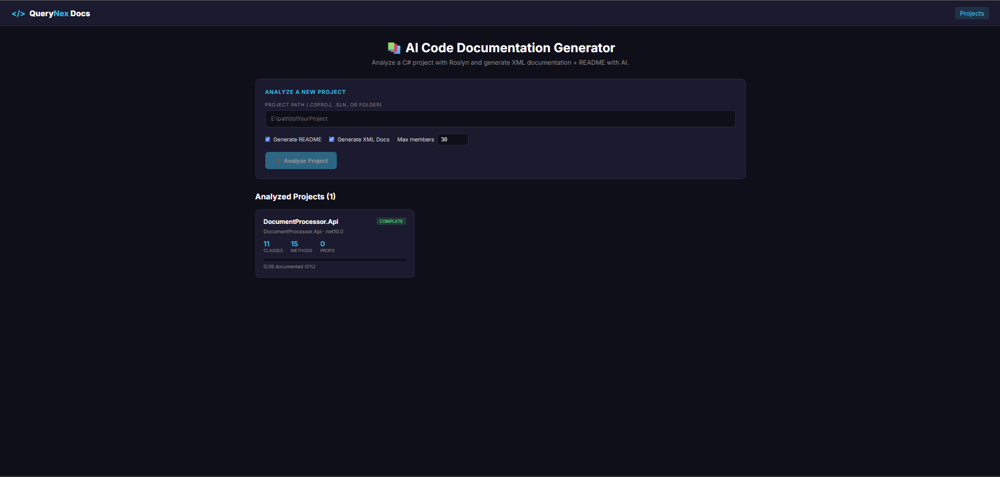
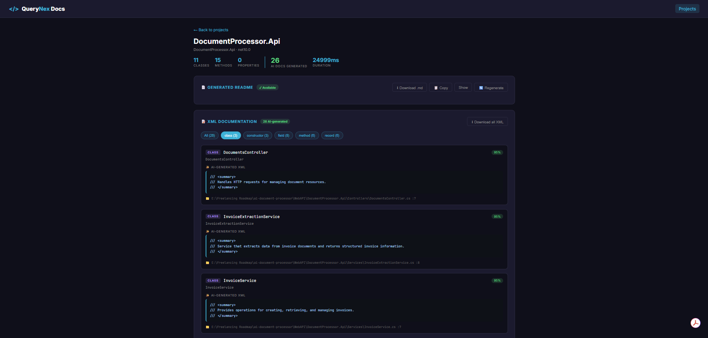
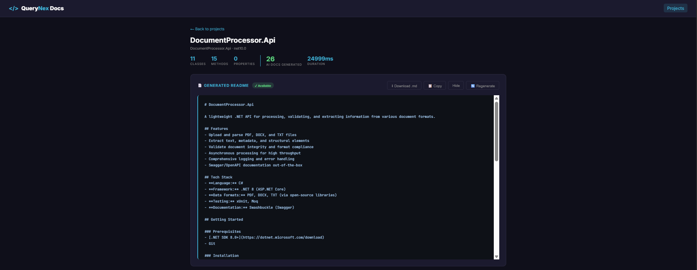
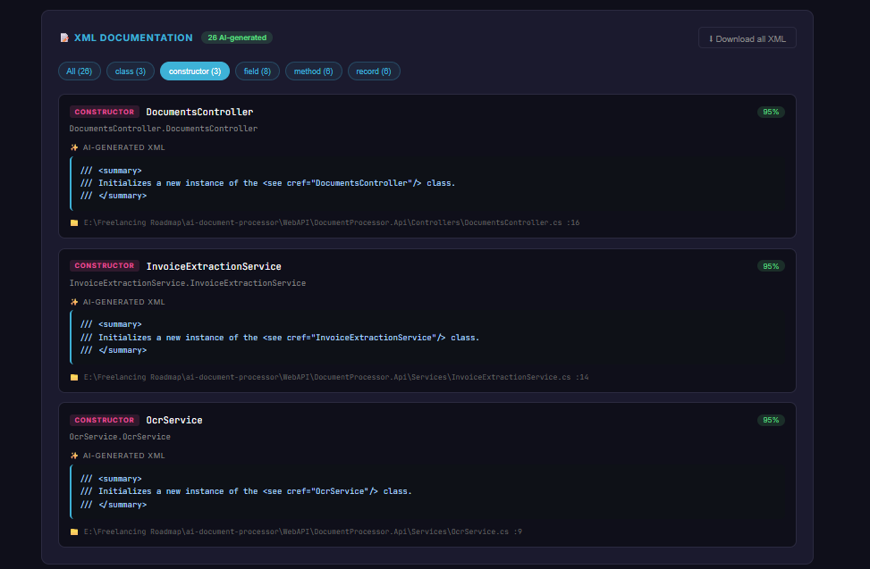

# AI Code Documentation Generator

> Roslyn-powered C# code analysis with AI-generated XML documentation comments and project READMEs.

[](https://dotnet.microsoft.com)
[](https://angular.io)
[](https://github.com/dotnet/roslyn)
[](https://www.postgresql.org)
[](https://groq.com)
[](LICENSE)

Point the tool at any C# project folder. It parses every `.cs` file with Roslyn, extracts every class, method, property, and constructor — then uses AI to generate or improve XML documentation comments for each member and a complete project README. All results are stored in PostgreSQL and displayed in a clean Angular dashboard.

This is a **real developer productivity tool** — not a demo. It's the kind of thing teams actually pay for.

---

## 📸 Screenshots

| Analyze Project | Project Detail — Side-by-Side Docs |
|-----------------|-----------------------------------|
|  |  |

| Generated README | Filter by Member Type |
|------------------|----------------------|
|  |  |

---

## ✨ Features

- 🔍 **Roslyn-Powered Parsing** — Walks C# syntax trees to find every type and member
- 📝 **AI-Generated XML Comments** — Clean, professional `<summary>`, `<param>`, `<returns>` tags
- 📄 **Auto-Generated README** — Project overview with features, tech stack, and setup
- 🎯 **Regenerate on Demand** — Re-run README generation without re-analyzing the whole project
- 📊 **Documentation Coverage** — See exactly which members are documented vs. not
- 🎨 **Side-by-Side Comparison** — View original XML next to the AI's improved version
- 🔀 **Filter by Member Type** — Classes, methods, properties, constructors, events
- ⚡ **Rate-Limited + Retry-Safe** — Built for free-tier API limits (8K TPM)
- 🎛️ **Configurable Batch Size** — Cap members per run to control cost and duration
- ⏭️ **Smart Skipping** — Already-documented members are not re-processed
- 💾 **Full History** — Every analysis run is stored in PostgreSQL
- 🎯 **Confidence Scores** — Each generated doc carries a quality heuristic
- 🚀 **Fast & Self-Contained** — No MSBuild dependencies; runs anywhere .NET runs
- 🔐 **Secret Management** — Groq key and DB credentials in .NET User Secrets

---

## 🏗️ Architecture

```
┌────────────────────────────────────────────────────────────┐
│                    Angular 22 Frontend                     │
│  ┌───────────────┐  ┌────────────────┐  ┌──────────────┐  │
│  │ Analyze Panel │  │ Projects List  │  │ Project      │  │
│  │ (path + opts) │  │ (cards + KPIs) │  │ Detail       │  │
│  └───────────────┘  └────────────────┘  └──────────────┘  │
└──────────────────────────┬─────────────────────────────────┘
                           │ HTTP
                           ▼
┌────────────────────────────────────────────────────────────┐
│                  .NET 10 Web API                           │
│                                                            │
│  ┌─────────────────────┐  ┌──────────────────────────────┐│
│  │ ProjectsController  │  │ RoslynAnalysisService        ││
│  │ ─ POST /analyze     │  │  (Microsoft.CodeAnalysis)    ││
│  │ ─ GET  /            │  └──────────────────────────────┘│
│  │ ─ GET  /{id}        │  ┌──────────────────────────────┐│
│  │ ─ POST /{id}/readme │  │ DocGenerationService         ││
│  └─────────────────────┘  │  • Rate limiter (8K TPM)     ││
│                           │  • Retry w/ backoff          ││
│                           │  • Skip documented members   ││
│                           └──────────────────────────────┘│
│                           ┌──────────────────────────────┐│
│                           │ DocumentationService         ││
│                           │  (Npgsql persistence)        ││
│                           └──────────────────────────────┘│
└──────────────────────────┬─────────────────────────────────┘
                           │
                           ▼
┌────────────────────────────────────────────────────────────┐
│      PostgreSQL (Neon) — reuses the e-commerce DB          │
│  Existing: customers, orders, products, invoices…          │
│  New:      analyzed_projects, generated_docs,              │
│            analysis_logs, project_readmes                  │
└────────────────────────────────────────────────────────────┘
```

**Request Flow:**

1. User enters a path to a `.csproj`, `.sln`, or folder in the Angular UI
2. Backend scans the folder recursively for `.cs` files (skipping `bin/`, `obj/`, `.vs/`)
3. `RoslynAnalysisService` parses each file with `CSharpSyntaxTree.ParseText`
4. Every `class`, `interface`, `record`, `struct`, `enum`, and their members are extracted
5. Existing XML documentation is captured alongside each member
6. Members **without** existing XML are sent to Groq, respecting a token budget limiter
7. `DocGenerationService` uses `gpt-oss-20b` (bulk model) for docs, `gpt-oss-120b` for the README
8. Groq returns valid XML documentation with a confidence heuristic
9. `DocumentationService` persists everything to PostgreSQL
10. Angular displays the results with filterable side-by-side comparison

---

## 🛠️ Tech Stack

| Layer | Technology | Version |
|-------|-----------|---------|
| **Frontend** | Angular (Standalone + Signals) | 22 |
| **Backend** | .NET Core Web API | 10 |
| **Code Analysis** | Microsoft.CodeAnalysis.CSharp (Roslyn) | 4.11.0 |
| **Database** | PostgreSQL | 16+ |
| **AI Provider** | Groq (OpenAI-compatible API) | `gpt-oss-120b` / `gpt-oss-20b` |
| **DB Driver** | Npgsql | 9.0.2 |

> **Note:** This project intentionally avoids `MSBuildWorkspace` and `MSBuildLocator`. Direct `CSharpSyntaxTree.ParseText` parsing is faster, has zero external dependencies, and avoids the notorious `Microsoft.Build.Framework Version=15.1.0.0` assembly-loading conflicts.

---

## 📁 Project Structure

```
ai-code-doc-generator/
├── WebAPI/
│   └── CodeDocGenerator.Api/
│       ├── Controllers/
│       │   └── ProjectsController.cs
│       ├── Models/
│       │   └── Dtos.cs
│       ├── Services/
│       │   ├── RoslynAnalysisService.cs
│       │   ├── DocGenerationService.cs
│       │   └── DocumentationService.cs
│       ├── Program.cs
│       └── appsettings.json
├── code-doc-generator-ui/
│   └── src/
│       └── app/
│           ├── projects/
│           │   ├── projects.ts
│           │   ├── projects.html
│           │   └── projects.css
│           ├── project-detail/
│           │   ├── project-detail.ts
│           │   ├── project-detail.html
│           │   └── project-detail.css
│           ├── project.service.ts
│           ├── app.ts
│           ├── app.config.ts
│           └── app.routes.ts
├── database/
│   └── 07_code_documentation.sql
├── docs/
│   └── screenshots/
├── .gitignore
├── LICENSE
└── README.md
```

---

## 🚀 Getting Started

### Prerequisites

- [.NET 10 SDK](https://dotnet.microsoft.com/download/dotnet/10.0)
- [Node.js 22.12+](https://nodejs.org)
- [Angular CLI 22+](https://angular.io/cli) (`npm install -g @angular/cli@latest`)
- [PostgreSQL 16+](https://www.postgresql.org/download/) — or a free [Neon](https://neon.tech) account
- [Groq API Key](https://console.groq.com) — free, no credit card

---

### 1️⃣ Database Setup

This project **reuses the e-commerce database** from the AI SQL Query Generator, AI Support Agent, and Intelligent Document Processing projects.

```bash
psql "postgresql://...neon.tech/neondb?sslmode=require" -f database/07_code_documentation.sql
```

This creates four new tables:

| Table | Purpose |
|-------|---------|
| `analyzed_projects` | Project-level metadata and stats |
| `generated_docs` | Per-member AI-generated XML documentation |
| `analysis_logs` | Event log for debugging and audit |
| `project_readmes` | AI-generated READMEs per project |

---

### 2️⃣ Backend Setup

```powershell
cd WebAPI/CodeDocGenerator.Api
dotnet restore
dotnet user-secrets init
```

**Configure secrets:**

```powershell
# Groq API key
dotnet user-secrets set "Groq:ApiKey" "gsk_your_actual_key"

# Model selection — 120b for README (1 call), 20b for bulk docs (many calls)
dotnet user-secrets set "Groq:Model" "openai/gpt-oss-120b"
dotnet user-secrets set "Groq:BulkModel" "openai/gpt-oss-20b"

# Database
dotnet user-secrets set "ConnectionStrings:DefaultConnection" `
  "Host=ep-xxx.neon.tech;Port=5432;Database=neondb;Username=neondb_owner;Password=...;SSL Mode=Require;Trust Server Certificate=true"
```

**Verify:**

```powershell
dotnet user-secrets list
```

**Run the API:**

```powershell
dotnet run --launch-profile https
```

API runs at `https://localhost:7249` (check `launchSettings.json` for your actual port).
Swagger UI: `https://localhost:7249/swagger`

---

### 3️⃣ Frontend Setup

```powershell
cd code-doc-generator-ui
npm install
```

**Update the API URL** in `src/environments/environment.development.ts`:

```typescript
export const environment = {
  production: false,
  apiBase: 'https://localhost:7249/api'
};
```

**Run the dev server:**

```powershell
ng serve --open
```

Frontend runs at `http://localhost:4200`.

---

### 4️⃣ Analyze Your First Project

1. Open `http://localhost:4200`
2. In the "Analyze a New Project" field, paste a path to any C# project:

   ```
   E:\Freelancing Roadmap\ai-code-doc-generator\WebAPI\CodeDocGenerator.Api
   ```

   Or point it at one of your other portfolio projects:

   ```
   E:\Freelancing Roadmap\ai-support-agent\WebAPI\SupportAgent.API
   ```

3. Set **Max members** to `20` on the first run (keeps the demo fast and stays within rate limits)
4. Keep **Generate README** and **Generate XML Docs** checked
5. Click **Analyze Project**
6. Wait 30–90 seconds depending on project size
7. Click the project card that appears to see the generated documentation

> **Try running it on itself** — a fun recursive demo that shows the tool analyzing its own source code.

---

## 🔌 API Reference

### `POST /api/projects/analyze`

Analyze a C# project folder.

**Request:**
```json
{
  "projectPath": "E:\\path\\to\\YourProject",
  "generateReadme": true,
  "generateXmlDocs": true,
  "maxMembers": 30
}
```

**Response:**
```json
{
  "projectId": 7,
  "success": true,
  "totalMembers": 84,
  "documentedMembers": 12,
  "undocumentedMembers": 72,
  "generatedCount": 30,
  "skippedCount": 54,
  "error": null
}
```

**Notes:**
- `maxMembers` caps how many members are processed per run
- `generatedCount` is the number of docs the AI produced
- `skippedCount` includes both already-documented members and members over the cap
- If the rate limiter kicks in, the response takes longer but still succeeds

---

### `GET /api/projects`

List all analyzed projects.

**Response:**
```json
[
  {
    "projectId": 7,
    "projectName": "CodeDocGenerator.Api",
    "assemblyName": "CodeDocGenerator.Api",
    "targetFramework": "net10.0",
    "totalFiles": 8,
    "totalClasses": 12,
    "totalMethods": 42,
    "totalProperties": 30,
    "documentedMembers": 12,
    "undocumentedMembers": 72,
    "analysisStatus": "complete",
    "analysisDurationMs": 45231,
    "analyzedAt": "2026-03-04T10:23:00Z"
  }
]
```

---

### `GET /api/projects/{id}`

Fetch full project detail with all generated docs and the README.

**Response:**
```json
{
  "projectId": 7,
  "projectName": "CodeDocGenerator.Api",
  "docs": [
    {
      "docId": 101,
      "memberType": "method",
      "memberName": "Analyze",
      "fullyQualifiedName": "RoslynAnalysisService.Analyze",
      "filePath": "E:\\...\\RoslynAnalysisService.cs",
      "lineNumber": 14,
      "originalXml": null,
      "generatedXml": "/// <summary>\n/// Analyzes a C# project by parsing all .cs files...\n/// </summary>",
      "aiConfidence": 0.95,
      "wasAccepted": false
    }
  ],
  "readmeContent": "# CodeDocGenerator.Api\n\n..."
}
```

---

### `POST /api/projects/{id}/readme`

Regenerate only the README for a project. Useful when the initial analysis ran out of tokens before the README step.

**Request:** empty body

**Response:**
```json
{
  "success": true,
  "length": 1842,
  "readme": "# CodeDocGenerator.Api\n\n..."
}
```

**On failure:**
```json
{
  "success": false,
  "length": 0,
  "readme": null,
  "error": "HttpRequestException: 429 Too Many Requests"
}
```

---

## 🤖 How AI Documentation Works

The project uses a **strict XML schema prompt** with Groq:

1. Each member's type, name, and existing XML (if any) are sent to Groq
2. Groq returns only the XML doc comment — no prose, no code fences
3. Response is stripped of markdown fences as a safety check
4. A heuristic confidence score is computed from structure + length
5. Results are persisted with the original for side-by-side comparison

### Rate-Limit Strategy

Groq's free tier caps at **8,000 tokens per minute (TPM)**. A naive loop over 84 members fires 84 requests back-to-back and hits the cap within seconds, killing the README step that runs afterward.

The solution has **four layers**:

| Layer | What It Does |
|-------|--------------|
| **Token-budget limiter** | Tracks cumulative tokens per rolling 60-second window; sleeps when nearing 7K |
| **Retry with backoff** | Catches 429s, parses Groq's "try again in Xs" hint, waits, retries up to 5 times |
| **Bulk model routing** | Uses `gpt-oss-20b` (higher limits) for per-member docs, `gpt-oss-120b` for the single README call |
| **Smart skipping** | Members that already have XML docs are not sent to the API |

### Other Safety Features

| Risk | Mitigation |
|------|-----------|
| Invalid output | Explicit "Return ONLY XML" instruction |
| Hallucination | Prompt requires "Be specific to the member's purpose" |
| Silent failures | Full error surfaced in UI + detailed console logs |
| Cost overrun | Analysis is user-initiated with `maxMembers` cap |
| Slow first runs | Rate limiter paces requests; smaller models respond faster |

---

## 🗄️ Database Schema

### New Tables

| Table | Purpose |
|-------|---------|
| `analyzed_projects` | Project metadata + aggregate stats |
| `generated_docs` | Per-member AI documentation records |
| `analysis_logs` | Event log (reserved for future use) |
| `project_readmes` | Generated README per project |

### Reused Tables

The schema lives in the **same database** as your e-commerce projects — no conflict since tables have distinct names.

---

## 🔒 Security

| Protection | Implementation |
|------------|---------------|
| **No remote file access** | Only local paths on the server are accepted |
| **Skip system folders** | `bin/`, `obj/`, `.vs/` are excluded from scan |
| **File size limit** | Per-file reads are bounded by default |
| **Secrets** | .NET User Secrets; never committed |
| **CORS** | Restricted to `http://localhost:4200` |
| **Read-only AI** | Generated docs are stored; no code is modified |
| **Path traversal** | Paths are validated as existing files/folders |

---

## 🧗 Challenges Solved

- **MSBuild assembly conflicts** — Abandoned `MSBuildWorkspace` after repeated `Version=15.1.0.0` loading errors; switched to direct `CSharpSyntaxTree.ParseText`, which is simpler, faster, and has zero external dependencies
- **Groq 429 rate limits** — Built a token-budget limiter with exponential backoff; split models between bulk (20b) and README (120b); added member skipping
- **Missing pipe error** — Replaced the `filterByType` pipe reference with an in-component `countByType()` method
- **Schema typo** — Fixed `readmes_project` → `project_readmes` in the index statement
- **NuGet transitive conflicts** — Removed `Microsoft.Build.Framework`, `Microsoft.Build.Locator`, and `Microsoft.CodeAnalysis.Workspaces.MSBuild` packages entirely
- **Member extraction** — Walked `BaseTypeDeclarationSyntax` → `TypeDeclarationSyntax.Members` to capture types and their members in one pass
- **Existing XML preservation** — Extracted `DocumentationCommentTriviaSyntax` from leading trivia to send to the AI as context
- **Silent README failures** — Added `/readme` endpoint and "Generate README" button so users can retry without re-running analysis

---

## ☁️ Deployment

| Component | Recommended Service | Free Tier |
|-----------|--------------------|-----------|
| **Frontend** | Azure Static Web Apps | 500 MB, 100 GB bandwidth |
| **Backend** | Azure App Service (F1) | 1 GB disk, 60 min CPU/day |
| **Database** | Neon | 0.5 GB, auto-suspend |
| **AI** | Groq | Generous free tier (8K TPM) |

**Deployment notes:**

- **File system access** — The backend needs read access to source code. On App Service, you must upload the target project into the app's workspace, or mount a persistent volume. For a portfolio demo, this is often acceptable.
- **Alternative:** Support `.zip` upload of a project. This avoids file system coupling and makes deployment easier.
- **App Service env vars** — Set `Groq__ApiKey`, `Groq__Model`, `Groq__BulkModel`, and `ConnectionStrings__DefaultConnection` in Configuration → Application settings (use double underscore for nesting)
- **Update `environment.ts`** — Point to the production API URL before building the Angular app

---

## 🧪 Sample Test Cases

| Target | Expected Behavior |
|--------|-------------------|
| Small console app (~5 files) | Full analysis in under 20 seconds |
| Medium Web API (~50 files) | Analysis in 1–3 minutes with rate limiting |
| This project (self) | Recursive demo |
| Non-C# project folder | Zero members extracted; friendly error |
| Folder with `bin/`/`obj/` | Those folders are skipped |
| Project with existing XML docs | Skipped by default (not re-generated) |
| Project with no XML docs | AI generates them from signatures |
| Re-run on same project | Nearly instant (all members already documented) |

---

## 🤝 Contributing

Contributions, issues, and feature requests are welcome!

1. Fork the repository
2. Create a feature branch (`git checkout -b feature/amazing-feature`)
3. Commit your changes (`git commit -m 'Add amazing feature'`)
4. Push the branch (`git push origin feature/amazing-feature`)
5. Open a Pull Request

---

## 📄 License

This project is licensed under the MIT License — see the [LICENSE](LICENSE) file for details.

---

## 👤 Author

**QueryNex**
- Portfolio: [querynexai.github.io](https://querynexai.github.io)
- GitHub: [@querynexai](https://github.com/querynexai)
- Email: querynex.ai@outlook.com

---

## ⭐ Show Your Support

If this project helped you, please give it a star ⭐ — it helps others discover it too.

---

## 🙏 Acknowledgements

- [Roslyn](https://github.com/dotnet/roslyn) for the incredible C# compiler platform
- [Groq](https://groq.com) for fast, free LLM inference
- [Neon](https://neon.tech) for serverless PostgreSQL
- The open-source .NET, Angular, and PostgreSQL communities

---

## 🎯 Project Status

| Component | Status |
|-----------|--------|
| Roslyn parsing | ✅ Working |
| Member extraction | ✅ Working |
| AI XML doc generation | ✅ Working |
| README generation | ✅ Working |
| Rate limiting + retry | ✅ Working |
| Regenerate README button | ✅ Working |
| Confidence scoring | ✅ Working |
| Filter by member type | ✅ Working |
| Side-by-side comparison | ✅ Working |
| Download README / XML | ✅ Working |
| Database persistence | ✅ Working |
| README + LICENSE | ✅ Ready |